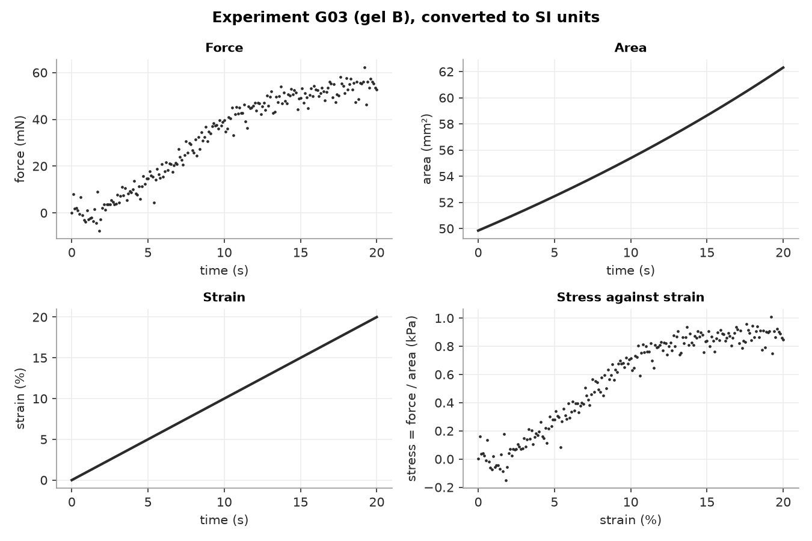
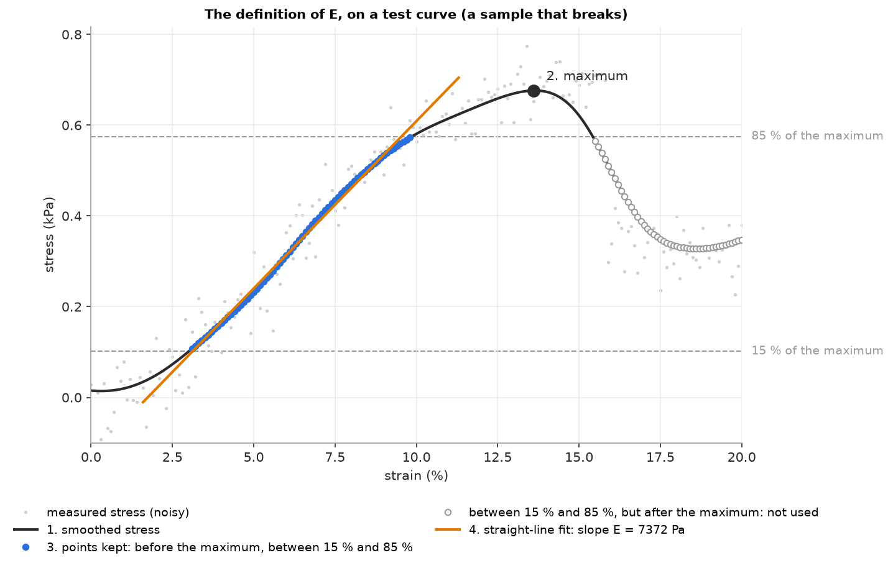

# Final exercise — How stiff is each gel?

A lab has tested four types of hydrogel (**gel A**, **gel B**, **gel C**, **gel D**) in compression: 64 cylinders, sixteen of each type, on two different testing machines. Everything is in one Zarr store, `data/gels.zarr`.

## The question

**What is the Young's modulus E of each type of gel — and how much does the answer depend on how much the data are smoothed?**

You will answer with a table: the average E of each type, in kPa, with its standard deviation, for three different amounts of smoothing.

## You have done this before

This is Assignment 5 again, on a new problem. The shape is the same:

```
 gels.zarr ──► load_experiment ──► stress_strain ──► smooth ──► young_modulus ──► E of each experiment
 (two machines,  SI units,            Pa and %          less noise    the definition below      │
  many units)    whatever machine                                                               ▼
                                                                          per type: mean and spread ──► the table
```

The first step deals with how the data happen to be stored and turns every experiment into **one standard format** (SI units). Everything after it is written once, for that format. The problem has already been **defined** and **decomposed** for you: the steps above, with fixed names. The specification of each step, the tests and the judgement on the results are yours.

## The data

`data/gels.zarr` has one group per experiment (`G01` … `G64`), with an attribute `type` (`"gel A"`, …) and an attribute `machine` (`"A"` or `"B"`). Inside each group, one 2-D array, `data`: one row per measurement, three columns. The two machines store the same test differently:

| | machine A | machine B |
|---|---|---|
| order of the columns | force, area, strain | strain, force, area |
| array attribute `columns` | `["force", "area", "strain"]` | `["strain", "force", "area"]` |
| force | in the unit named by `force_unit`: `"N"` or `"mN"` | `force_exp`: force × 10**`force_exp` is in N |
| area | in the unit named by `area_unit`: `"m^2"`, `"cm^2"` or `"mm^2"` | `area_exp`: area × 10**`area_exp` is in m² |
| strain | a fraction, no units (0.05 = 5 %) | the same |

What else you need to know:

- The units **vary from experiment to experiment**, even on the same machine: read them from each experiment's attributes.
- The machine compresses at a constant rate, **1 % strain per second**, and records one point every 0.1 s: a test lasts 20 s and has 201 points, from strain 0 to 0.20 in steps of **0.001 (0.1 %)**. Time is not stored: the strain tells you the same thing. A smoothing width of **10 points is 1 % strain**, in every experiment.
- The area is measured during the test, so it changes from point to point. Stress is force / area **at every point**.
- The force carries **sizeable noise**. The strain does not.
- Some samples **break** before the end of the test: their stress drops suddenly.
- The study is raw data: **it must never be changed**.

## What one test looks like

One experiment of the study, after conversion to SI units (force and area are plotted in mN and mm² to keep the numbers readable):



Force, area and strain are what the machine records. The stress (force / area) against the strain is the curve E is measured on: a toe at the start, where the curve steepens; a short part that is close to straight; and a plateau, where it flattens — under a lot of noise. You will not need to draw graphs in this exercise; the figures are here so that you know what the numbers look like.

## The definition of E

E is defined as:

> 1. Smooth the stress.
> 2. Find the maximum of the smoothed stress.
> 3. Keep the points **before** the maximum whose smoothed stress is between **15 %** and **85 %** of that maximum.
> 4. Fit a straight line to the smoothed stress against the strain (as a fraction) on those points. The slope is **E**, in Pa.

This is a definition, not the "true" stiffness of the material: on a curve that is not straight, a different definition gives a different number. Fixing it is what makes the numbers of different experiments, and of different people, comparable.

Here are the four steps on a test curve of a sample that breaks (smoothed with a Gaussian filter, width 10 points):



Only the blue points are fitted. The open points are also between 15 % and 85 % of the maximum, but they come after it, when the sample is breaking: that is why step 3 says **before**.

## Your digital data: curves whose E you know

Before you trust your functions on 64 experiments, test them on curves whose E you know — because **you made them**. Build them with numpy, in your test file, on the same strain axis as the real tests (`np.arange(0, 20.1, 0.1)`: 0 to 20 %, every 0.1 %). Add one difficulty at a time:

| curve | how to make it | what it checks | expected E |
|---|---|---|---|
| a straight line | stress = E × strain (strain as a fraction) | the definition and the units | the E you chose, exactly |
| a line that bends | straight up to some strain, then much less steep (`np.where`) | the 85 % bound: the part after the bend must not be fitted | the E you chose, exactly |
| the same, with noise | add `np.random.default_rng(0).normal(0, sd, n)`; an sd of 5 % of the maximum stress is close to the real tests | the smoothing | the E you chose, within 5 % |
| a sample that breaks | after some strain, the stress drops (for example to 40 % of the maximum) | "before the maximum" | the E you chose, exactly |

Choose a realistic E (the gels are in the kPa range) and write it in the test's docstring: it is your expected value, known by construction.

**Choosing the width.** On the noisy curve, try several widths and write down the E you get for each. With too little smoothing, the noise moves the maximum and the points selected; with too much, the corner where the line bends is rounded and pulled into the fit. The width you trust is chosen **here**, where you know the answer — not on the real data.

## The small store, for your tests

`data/tiny.zarr` has three experiments, **without noise**, one for each way of storing units: `T01` (machine A), `T02` (machine B), `T03` (machine A, other units). Each one was also exported by its machine **in SI units**, as a text file you can open in VS Code: `data/T01_si.csv`, `T02_si.csv`, `T03_si.csv`. They are your independent check of the loader. Their known E (the definition, no smoothing), rounded — **within 1 %** is the target:

| experiment | type | known E |
|---|---|---|
| T01 | gel A | 5370 Pa |
| T02 | gel B | 9500 Pa |
| T03 | gel B | 10100 Pa |

## The functions (in `mechanics.py`; names and parameters fixed)

Write **five separate functions**, each with its own `# PROMPT` block. Do not put one inside another.

| function | takes | returns |
|---|---|---|
| `load_experiment(store_path, experiment_id)` | the store and one id | a record: `"experiment_id"`, `"type"`, `"force_n"` (N), `"area_m2"` (m²), `"strain"` (a fraction); the last three as numpy arrays |
| `stress_strain(record)` | a record | `{"strain_pct": ..., "stress_pa": ...}`: strain in %, stress in Pa, numpy arrays |
| `smooth(stress_pa, width_points)` | a stress curve; the width of the filter, in points | the smoothed stress (a new array). Width 0 = unchanged |
| `young_modulus(strain_pct, stress_pa)` | strain in %; a stress that is **already smoothed** | E in Pa, by the definition above |
| `run_pipeline(store_path, width_points)` | the store; the width | for every type: `{"mean_E_pa": ..., "sd_E_pa": ..., "n": ...}` |

`run_pipeline` goes through every experiment **in alphabetical order**, calls the steps above, groups the E values by type, and returns one entry per type, in alphabetical order: the mean of E, its standard deviation (with n − 1 in the denominator; `numpy.std` with `ddof=1`), and the number of experiments. A type with a single experiment has no standard deviation: say in the prompt what `sd_E_pa` should be then (for example `float("nan")`).

One choice is yours: **the smoothing.** Use a filter from a library: filters for 1-D signals are in `scipy.ndimage` (for example `gaussian_filter1d`) and `scipy.signal`; `skimage.filters`, from scikit-image (which you will use on images next year), also works on 1-D arrays. Which filter, and what `width_points` means for it, is your decision. Write it in the prompt and in the README.

## The files you start from

| file | what to do with it |
|---|---|
| `mechanics.py` | the five functions: a prompt in each `# PROMPT` block, the body that came back under each signature |
| `test_mechanics.py` | your tests, with pytest |
| `given.py` | given: `read_table(path)` reads any of the CSV files into `{column name: numpy array}`. Use it in your tests. Do not change it |
| `main.py` | given: prints the table for three smoothing widths. **Choose the three widths** (the only line you change) |
| `data/` | `gels.zarr`, `tiny.zarr` and the `T0*_si.csv` exports: never written to |
| `img/` | the two figures of this brief |
| `README_template.md` | copy it to `README.md` and fill it in |

## What to do

1. **Set up.** Unzip into a new folder, open it in VS Code, create the `.venv`, select the interpreter, install what you need. `python -m pytest` should say *1 failed*: the example test in `test_mechanics.py`, whose body is not written yet.
2. **Look at the data by eye.** Open the `zarr.json` files of the three experiments in `tiny.zarr`. For each one, write down in the README: machine, order of the columns, units of force and area, and the number you must multiply each by to get N and m². Then do the same for three experiments of `gels.zarr` of your choice.
3. **The definition first, on your digital data.** Write the prompts for `smooth` and `young_modulus`; build the four curves of "Your digital data" and their tests. Try several widths on the noisy curve and write down what you see: this is where you choose yours.
4. **The loader.** Write the prompts for `load_experiment` and `stress_strain`, and test the loader on `T01`, `T02` and `T03` against their `_si.csv` exports.
5. **The pipeline.** Write the prompt for `run_pipeline`. A prompt can say that the other four functions exist, and what each one takes and returns. Test it on `tiny.zarr` with width 0: the means must be the known values above, within 1 % (for gel B, the mean of T02 and T03). All the tests to write are listed in the next section.
6. **Run the job.** Choose the three widths in `main.py` — one too small, the one you trust, one too large — and run `python main.py`. Paste the table in the README.
7. **Write `requirements.txt`**, then do the **clean rebuild**: zip your folder without `.venv` and without `data/`, unzip it into a new, empty folder, copy the `data/` folder of the starting pack into it, create a new `.venv`, `python -m pip install -r requirements.txt`, `python -m pytest`, `python main.py`. Paste the outputs in the README.
8. **Fill in `README.md`.**

## The tests (pytest, in `test_mechanics.py`)

Every check above is a pytest test: a `test_...` function, run with `python -m pytest`. Data whose answer is known — the curves you built and the small store — are your digital data. At least these seven:

| test | data | expected value (its source) | comparison |
|---|---|---|---|
| E on a straight line | your straight line, width 0 | the E you chose (by construction) | `pytest.approx(E, rel=1e-6)` |
| E on a line that bends | your curve, width 0 | the E you chose | `pytest.approx(E, rel=1e-6)` |
| E on a noisy curve | your bending curve + noise, your width | the E you chose | `pytest.approx(E, rel=0.05)` |
| E on a sample that breaks | your breaking curve, width 0 | the E you chose | `pytest.approx(E, rel=1e-6)` |
| loader, machine A | `T01` in `tiny.zarr` | force, area and strain of `T01_si.csv` | `pytest.approx(..., rel=1e-6)` on each array |
| loader, machine B | `T02` in `tiny.zarr` | the same, from `T02_si.csv` | `pytest.approx(..., rel=1e-6)` on each array |
| the pipeline | `tiny.zarr`, width 0 | gel A 5370 Pa; gel B (9500 + 10100) / 2 = 9800 Pa, n = 2 (the table above) | `pytest.approx(..., rel=0.01)` |

The tolerance is part of the specification: why can it be 10⁻⁶ on a curve without noise, but only 5 % on a noisy one? For every test, the expected value is written by you, with its source, in the docstring. The bodies come from an assistant in a **separate chat** that never sees `mechanics.py`. More tests are welcome (`T03`, a curve with too few points, …).

## Submit (on Moodle, by Friday 20 November)

One zip of your folder, **without** `.venv` and **without** `data/` (we run your code on our own copy of the data):

- `mechanics.py`, `test_mechanics.py`, `given.py`, `main.py`
- `requirements.txt`
- `README.md`
- the **transcript** of your AI chats: every chat, from the first prompt to the last

Submission is anonymous: put no name in any file.
