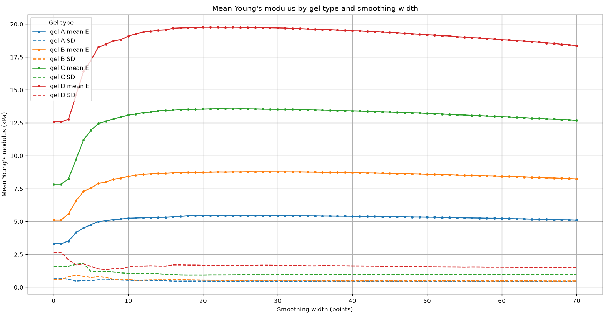
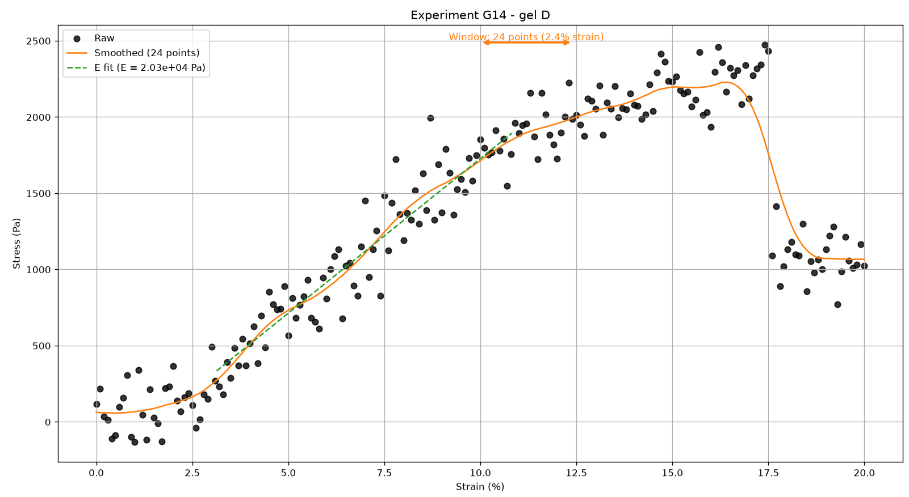

# How stiff is each gel? — README

## 1. The data, read by eye

For each experiment: the machine, the order of the columns, the units of force and area as stored, and the number you multiply each by to get N and m².

| experiment | machine | columns | force unit | × to get N | area unit | × to get m² |
|---|---|---|---|---|---|---|
| T01 | A | Force Area Strain | mN | 1e-3 | mm^2 | 1e-6 |
| T02 | B | Strain Force Area | mN | 1e-3 | mm^2 | 1e-6 |
| T03 | A | Force Area Strain | N | 1 | cm^2 | 1e-4 |
| G01 | A | Force Area Strain | mN | 1e-3 | m^2 | 1 |
| G02 | B | Strain Force Area | N | 1 | mm^2 | 1e-6 |
| G03 | A | Force Area Strain | mN | 1e-3 | m^2 | 1 |

## 2. My decisions

- **Smoothing**:
a Gaussian-weighted moving average implemented with NumPy - `width_points` is the full window width in % strain, the edge weight is 0.1 of the center weight, and endpoint weights are renormalized (somehow, still don't really know how that works but the graph looks good enough). I chose my width values by making a plot of the data in `graph_experiment.py` and iterating over width values until one suited the data nicely.
- **The width I trust**, and why:

I didn't go online to look up what widths would be best for this specific calculation but here's what I found.

The width really only affects the smoothened maximum stress value, which changes what points are counted for the gradient - even if the data is noisy the gradient can still be found about just as well.

I also decided to make the gausian weight 0.1 rel to centre just based on vibes

Iterating over a few values with `graph_experiment.py` I found that 45 points was a nice number.

Since the gradient increases from gels A to D, I used D to check my width_points since its the hardest to smooth nicely.

Later when writing this README.md (6. How stable is the answer?), I realised that the optimal width would probably be the one that gave the maximum mean E value, so I wrote a quick `find_optimal_width.py` to find that the width values were around 22 to 26

So I went with a width points of 24.



^ Fig 1, from `find_optimal_width.py`, E shows a peak around 24 and standard deviations (SD) remain around the same value



^ Fig 2, from `graph_experiment.py`, the higher noise from the lower 24 width about evens out when the line is plotted. (the line is exactly cut of outside the calculated 15% and 85% maximum)

## 3. What the assistant decided that I had not asked for

Using root mean square method to fit the gradient line

Smoothing around data edges. It was not secified what way to and it chose to renormalise the weights when near the edges.

Inclusion of points exactly at 85% or 15% of maximum for E calculation. This wasn't really necessary since floats rarely exactly equal but I told it to be inclusive with point inclusion.

I didn't explicitly require zarr3 (I forgot to) but I have preinstalled zarr3 with pip before running the prompt. It correctly assumed zarr3.

## 4. Diagnosis log

Every failure you met: what happened, which kind it was (the specification, the call, the body, the file, the environment), and what you changed. At least three entries.

| what happened | kind | what I did |
|---|---|---|
| The E calculation took the right types of values, but it used strain as a % instead of a fraction directly in the final calculation | specification | A seperate agent from the `run_pipeline` prompt caught this and put it in its plan to fix it which I thought was wierd so I investigated and fixed it myself. |
| `width_points` was defined as % strain instead of what `main.py` specified | specification | I found out about it after finishing `run_pipeline` and reading `main.py` (which I didn't earlier). I then fixed it in `transcripts/mechanics/fix_width_points` |
| implementation of `width_points` in `smooth` was completely different to expected. In the `smooth` prompt, I mistakenly told the agent to put a global constant as the smoothening window, since I thought width_points was something else I didn't have to worry about. | specification | also `transcripts/mechanics/fix_width_points` |

## 5. Results

The output of `python main.py`, pasted as it is:

```text
width   5 points (0.5 % strain) | gel A:   4.75 ± 0.50 kPa (n = 16) | gel B:   7.55 ± 0.75 kPa (n = 16) | gel C:  11.93 ± 1.18 kPa (n = 16) | gel D:  17.25 ± 1.59 kPa (n = 16)
width  24 points (2.4 % strain) | gel A:   5.44 ± 0.46 kPa (n = 16) | gel B:   8.77 ± 0.52 kPa (n = 16) | gel C:  13.56 ± 0.94 kPa (n = 16) | gel D:  19.76 ± 1.65 kPa (n = 16)
width 100 points (10.0 % strain) | gel A:   4.60 ± 0.41 kPa (n = 16) | gel B:   7.44 ± 0.46 kPa (n = 16) | gel C:  11.43 ± 0.96 kPa (n = 16) | gel D:  16.57 ± 1.43 kPa (n = 16)
```

## 6. How stable is the answer?

The averages don't change much with the width because the only thing that really affects the average is where the 85% and 15% points are set, which is also pretty stable (since the peaks are relatively flat on average). Other noise in the points between 85% and 15% can be decently filtered out just as well with the root mean square method to chose the line.

At very low widths (< 5 points), the line at the top was jittery, which increased the maximum stress, causing the 85% and 15% cutoffs to be higher, so more of the region is in the flat peak above (which has a lower gradient), thus decreasing E.

At very high widths (>100), the line was becoming overly flat because it sampled from the entire data set, which also decreased E.

Though even with the most difficult sample gel D (since it had the highest E and thus the least straight line), you can see from the Fig 2 above that the E values doesn't change that much over widths.

## 7. The clean rebuild

The outputs of `python -m pip install -r requirements.txt` (the last line), `python -m pytest` and `python main.py` in a new, empty folder (your zip, plus the `data/` folder of the starting pack):

`python -m pip install -r requirements.txt`:

```text
Installing collected packages: tzdata, typing_extensions, PyYAML, pyparsing, Pygments, pluggy, pillow, packaging, numpy, msgspec, kiwisolver, iniconfig, google-crc32c, fonttools, cycler, colorama, python-dateutil, pytest, numcodecs, donfig, contourpy, zarr, matplotlib
Successfully installed PyYAML-6.0.3 Pygments-2.21.0 colorama-0.4.6 contourpy-1.4.0 cycler-0.12.1 donfig-0.8.1.post1 fonttools-4.68.0 google-crc32c-1.9.0 iniconfig-2.3.1 kiwisolver-1.5.1 matplotlib-3.11.2 msgspec-0.22.0 numcodecs-0.17.1 numpy-2.5.4 packaging-26.3 pillow-13.0.0 pluggy-1.7.0 pyparsing-3.3.3 pytest-9.2.0 python-dateutil-4.0.0 typing_extensions-4.16.0 tzdata-2026.6 zarr-3.4.2
```

`python -m pytest`:

```text
===================================================================== test session starts =====================================================================
platform win32 -- Python 3.14.7, pytest-9.2.0, pluggy-1.7.0
rootdir: C:\Programming-Stuff\User\Final-Week
plugins: zarr-3.4.2
collected 7 items                                                                                                                                              

test_mechanics.py .......                                                                                                                                [100%]

====================================================================== warnings summary =======================================================================
test_mechanics.py::test_tiny_pipeline_matches_expected_gel_moduli
  C:\Programming-Stuff\User\Final-Week\.venv\Lib\site-packages\numpy\_core\_methods.py:219: RuntimeWarning: Degrees of freedom <= 0 for slice
    ret = _var(a, axis=axis, dtype=dtype, out=out, ddof=ddof,

test_mechanics.py::test_tiny_pipeline_matches_expected_gel_moduli
  C:\Programming-Stuff\User\Final-Week\.venv\Lib\site-packages\numpy\_core\_methods.py:211: RuntimeWarning: invalid value encountered in scalar divide
    ret = ret.dtype.type(ret / rcount)

-- Docs: https://docs.pytest.org/en/stable/how-to/capture-warnings.html
================================================================ 7 passed, 2 warnings in 0.33s ================================================================
```

`python main.py`:

```text
width   5 points (0.5 % strain) | gel A:   4.75 ± 0.50 kPa (n = 16) | gel B:   7.55 ± 0.75 kPa (n = 16) | gel C:  11.93 ± 1.18 kPa (n = 16) | gel D:  17.25 ± 1.59 kPa (n = 16)
width  24 points (2.4 % strain) | gel A:   5.44 ± 0.46 kPa (n = 16) | gel B:   8.77 ± 0.52 kPa (n = 16) | gel C:  13.56 ± 0.94 kPa (n = 16) | gel D:  19.76 ± 1.65 kPa (n = 16)
width 100 points (10.0 % strain) | gel A:   4.60 ± 0.41 kPa (n = 16) | gel B:   7.44 ± 0.46 kPa (n = 16) | gel C:  11.43 ± 0.96 kPa (n = 16) | gel D:  16.57 ± 1.43 kPa (n = 16)
```

## Misc notes (I wrote them down already so why not)

agent tried to edit FINAL.md for some reason

In the `smooth` prompt, I mistakenly told the agent to put a global constant as the smoothening window, since I thought width_points was something else I didn't have to worry about. This caused the agent to implement some random thing for width_points and me fixing it in `transcripts/mechanics/fix_width_points`

The agent seemed to get tripped up by width_points a lot even during `transcripts/mechanics/fix_width_points` where it seemed to have misunderstood the code that the previous agent wrote and asked me questions on the edge weights and things.

The agents seem to like importing libraries inside functions if not already defined at the top, I had to manually move 2 imports back up.
